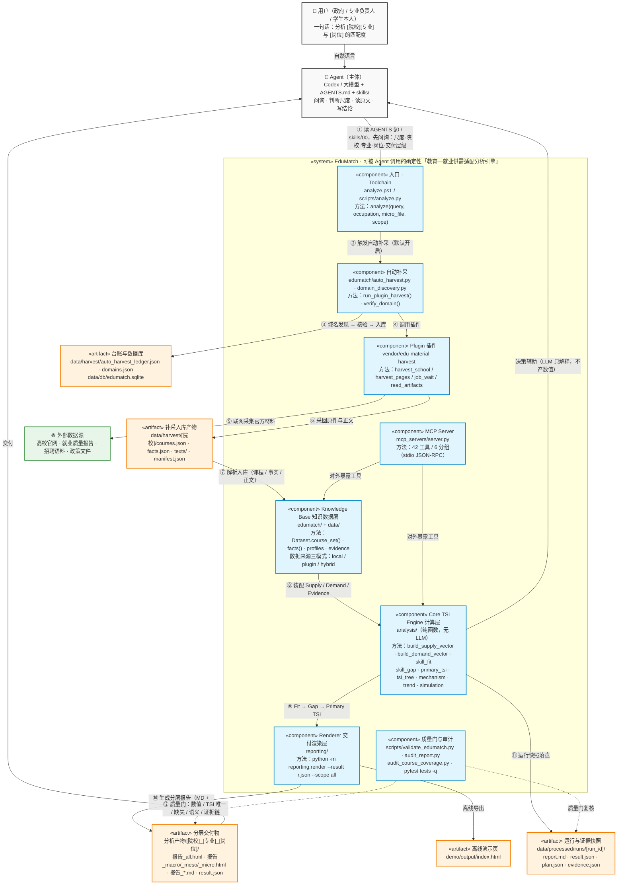

# EduMatch 系统 UML 图（Core 大系统全景）

> 定位：把整个 `EduMatch` 文件夹当作**一个大系统**，按 `PROMPT.md` 与 `AGENTS.md §0`
> 的真实工作路径，补齐**调用的东西（组件/参与者）→ 方法（入口命令与函数）→ 产物（落盘文件）**。
>
> 画法：采用 UML **组件图**约定（`«system»` 系统边界、`«component»` 组件、`«actor»` 参与者、
> `«artifact»` 产物），用 Mermaid `flowchart` 渲染；编号 ①–⑫ 即一次分析的执行顺序。

## 1. 系统 UML 图

## 2. 图例

| 记号 | 含义 | 对应实物 |
| --- | --- | --- |
| `«actor»` | 参与者和主体 | 用户、Agent（Codex / 大模型） |
| `«system»` | 系统边界 | 整个 `EduMatch` 文件夹 |
| `«component»` | 系统内被调用的组件 | Toolchain、AutoHarvest、Plugin、Knowledge Base、Core TSI Engine、Renderer、质量门、MCP Server |
| `«artifact»` | 产物（落盘文件） | 报告、result.json、运行快照、台账、采集入库件、演示页 |
| `-->` | 调用 / 数据流 | 编号 ①–⑫ 为一次分析的执行顺序 |
| `-.->` | 校验 / 非破坏性动作 | 质量门与审计 |

## 3. 工作路径（对应 `PROMPT.md` / `AGENTS.md §0`）

1. 用户一句话提出需求；Agent 先读 `AGENTS.md §0` 与 `skills/00_agent_entry/SKILL.md`，按 §2 多轮问询
   （尺度与对象 / 院校 + 专业 / 目标岗位 / 微观补充 / 交付层级）；目标不明确时只输出问询清单，不跑分析。
2. 目标确认后，Agent 调用**唯一入口**：`.\analyze.ps1 "<问题>" -Occupation "<岗位>" -Scope all`
   （等价 `python scripts\analyze.py --query "…"`）；这一条命令封装了补采 → 计算 → 渲染 → 质量门。
3. 系统默认开启**自动补采**：`edumatch/auto_harvest.py` 驱动 `vendor/edu-material-harvest` 插件
   （12 个 MCP 工具）采集本校 + 同类院校的全部材料类型；域名走「发现 → 核验 → 入库」，绝不猜域名。
4. 采集件落到 `data/harvest/[院校]/`，原件同步进 `data/source/`，由 `HarvestImporter` 解析入库。
5. `edumatch/` 装配 Knowledge–Skill–Capability–Practice 四层对象与 A–E 级证据链，供 `analysis/` 调用。
6. `analysis/` 是唯一产数值的地方：Supply → Demand → Fit → Gap → Primary TSI，并做 TSI Tree 分解。
7. `reporting/` 用 `python -m reporting.render` 生成分层交付物：`报告_all.html` 与
   `报告_macro/_meso/_micro.html`、同名 `.md`、`result.json`（补做只新增、不覆盖）。
8. 收尾跑质量门：`python scripts\validate_edumatch.py`（0 error）、`python scripts\audit_report.py`
   （维度自检，缺块返回 2），以及必要时的 `python -m pytest tests -q` 与课程覆盖核对。
9. 交付后 Agent 说明「发现了什么 / 改了什么 / 还缺什么 / 下一步」；需要更多同类校时按
   `-OfferUrl` 或 `-HarvestMode region -HarvestBatch N` 分批补采，台账累积在
   `data/harvest/auto_harvest_ledger.json`。
